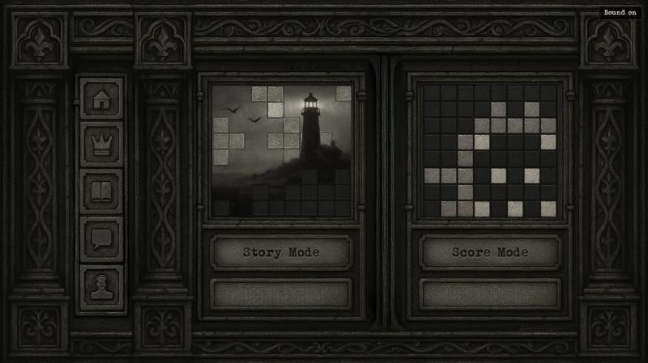
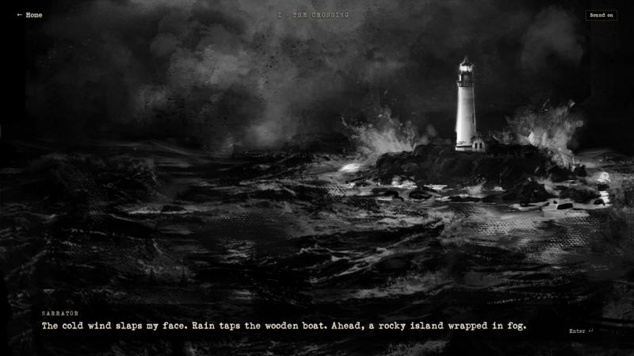
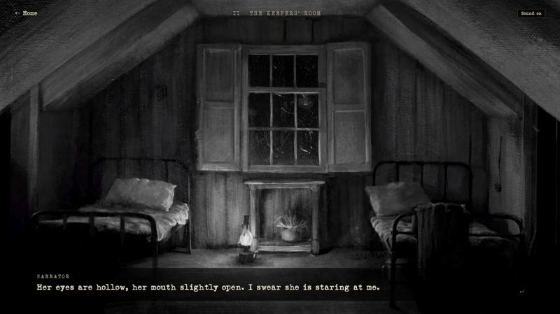
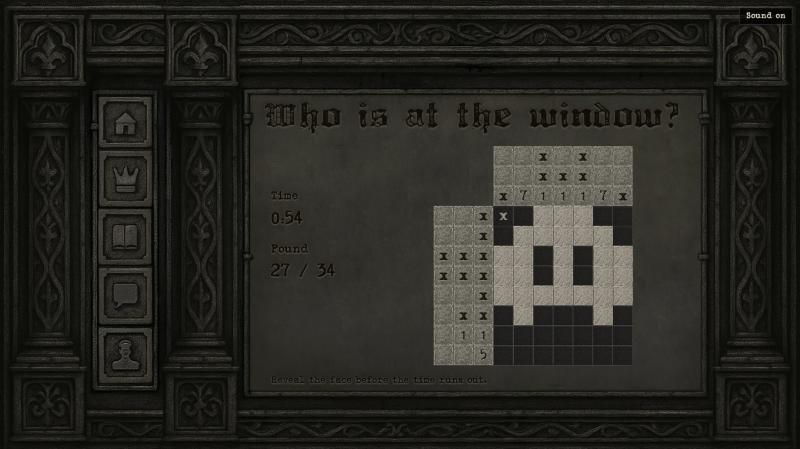
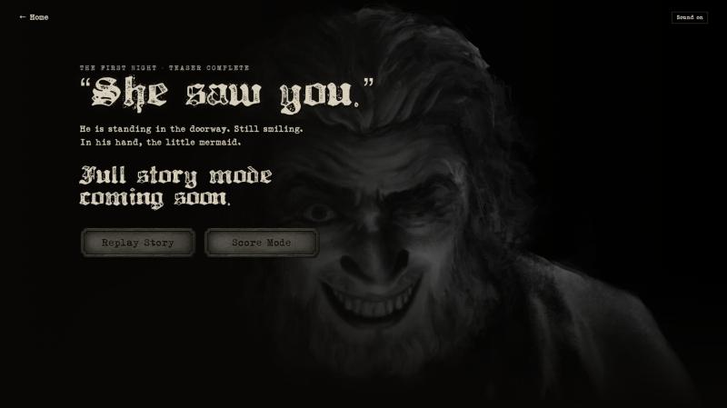
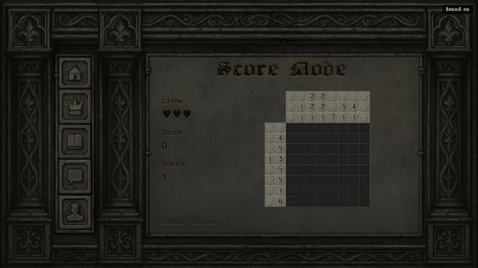
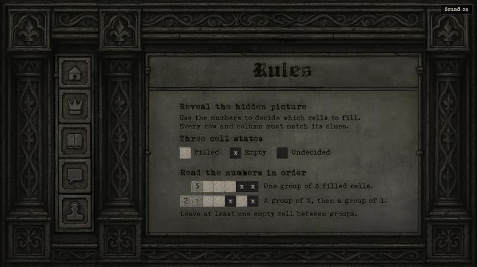
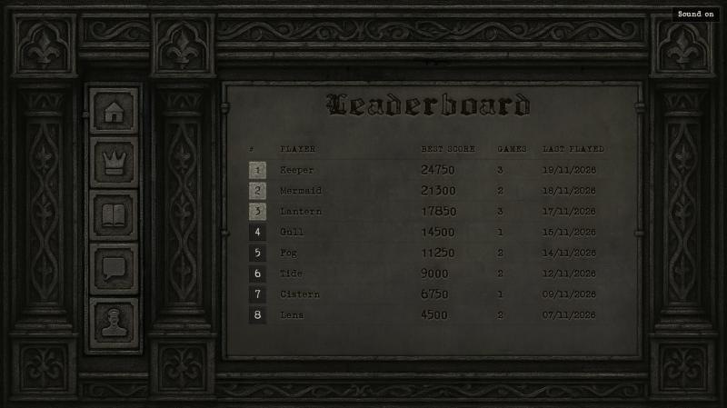
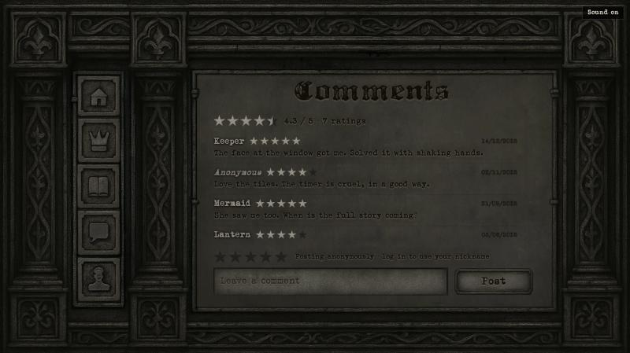

# Horror Nonogram

A horror-themed nonogram (Picross) game: a carved stone cabinet, monochrome paintings, textured tiles,
a short cinematic **Story Mode** teaser and an endless **Score Mode**, with a leaderboard and player comments.

Java 17 · Spring Boot 3 · PostgreSQL · React 19 (Create React App)



## Screens

| Story Mode — the crossing | Story Mode — the keepers' room |
|---|---|
|  |  |
| **Story Mode — the face at the window** | **Story Mode — ending** |
|  |  |
| **Score Mode** | **Rules** |
|  |  |
| **Leaderboard** | **Comments** |
|  |  |

## Features

**Story Mode** — a short trailer for a future story campaign, built from the original art and `story.txt`:
the boat crossing to the lighthouse (sea ambience) → the keepers' room → the first night, with footsteps that
come closer line by line → "I turn. In the window…" → a one-second screamer → the original window-face
nonogram from `story.txt` (7 × 8, 60 seconds) → *"Face. Pale. Hollow."* → *"She saw you."* · *Full story mode coming soon.*
Enter / Space / → or a tap advances the text. The screamer plays once per playback; a reload resumes at the puzzle.

**Score Mode** — one picture at a time, three lives for the whole run, each picture at most 8 × 8.
Pictures are pixel-art avatars from the DiceBear API converted to black and white;
if the API is slow or unavailable, a random 5–8 × 5–8 field is used instead.
A wrong tile costs a life and 50 points, a solved picture gives 250 points per filled tile and the next one starts
automatically. At Game Over the score of a logged-in player is saved to the leaderboard.

**Leaderboard** — registered players only, each with their best score (the top three on grey clue tiles).

**Comments** — 1–5 stars plus a comment; logged-in players post under their nickname, everyone else anonymously.
The stars are cut from the game's own tile textures.

**Also** — Rules with tile examples, Login and Sign Up on the original painted slots, procedural sound
(Web Audio: sea, room, footsteps, screamer, button and tile sounds, nothing downloaded) with a Sound on/off toggle,
and ordered loading: a page appears only when its background, icons and fonts are ready.

## Run locally

Requirements: JDK 17, Maven, Node.js 18+, PostgreSQL.

```sh
# 1. database (once)
psql -d postgres -f db/create-database.sql

# 2. server on :8080 (tables are created from the JPA entities, demo players/scores/comments are added once)
export JAVA_HOME=$(/usr/libexec/java_home -v 17)   # Lombok 1.18.26 does not support newer JDKs
mvn -DskipTests package
java -jar target/nonogram-1.0-SNAPSHOT.jar

# 3. web app on :3000 (/api is proxied to :8080 by src/setupProxy.js)
cd nonogram-web
npm ci
npm start
```

Database settings come from `DATABASE_URL`, `DB_USERNAME`, `DB_PASSWORD`
(default `jdbc:postgresql://localhost:5432/horror_nonogram`, user `postgres`, no password).
Demo data is controlled by `nonogram.demo-data` in `src/main/resources/application.properties`.

## API

| Method | Path | |
|---|---|---|
| POST | `/api/user/register` | `{login or player, email, password}` → text; passwords are stored as salted PBKDF2 |
| POST | `/api/user/login` | `{login, password}` → `OK` / `Invalid credentials`; the login is kept in the session |
| GET · POST | `/api/user/me` · `/api/user/logout` | session state |
| GET | `/api/leaderboard/nonogram` | best score per registered player |
| POST | `/api/score` | `{points}` for the logged-in player (401 for guests) |
| GET · POST | `/api/comment/nonogram` · `/api/comment` | comments with `rating` 1–5; guests post anonymously |
| GET | `/api/rating/nonogram` · `/api/rating/nonogram/{player}` | average rating / a player's rating |

## Project structure

```
src/main/java/sk/tuke/kpi/kp/nonogram/
  core/            field, generator, game modes (console game)
  consoleUI/       console client
  server/          Spring Boot server: REST controllers, entities, DemoData
  service/         JPA / JDBC / REST-client services
src/main/resources story.txt, original art, application.properties
db/                create-database.sql
nonogram-web/
  src/             pages, Story Mode (story/trailer.js), sound.js, preload.js, layout.js
  public/images    backgrounds, icons, tiles, story art (original PNG + WebP used by the site)
docs/              screenshots, Story Mode and server notes
```

More detail: [docs/STORY_MODE.md](docs/STORY_MODE.md) · [docs/SERVER.md](docs/SERVER.md)

## Notes

- All artwork, fonts, the story and the game design are by Vira Zablotska.
- The leaderboard and comments start with a few demo entries created by `DemoData` (accounts with an
  `@demo.invalid` e-mail that cannot log in; demo comments have `demo = true` in the database).
- Commit dates in this repository are set by hand and are not real development timestamps: the earlier history
  was reconstructed from a project snapshot, and the web/server/readme commits were made in November 2026
  and dated September 2026.
